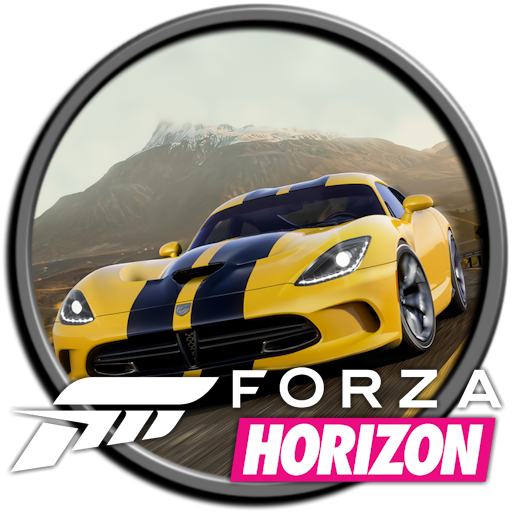

# Forza Horizon (Xbox 360) — Native iOS / iPadOS Port

<p align="center">
  
</p>

<p align="center">
  <b>Native <code>arm64-apple-ios</code> static recompilation port of the Xbox 360 release of <i>Forza Horizon</i> for iPhone and iPad.</b><br>
  Powered by Vulkan via <a href="https://github.com">MoltenVK</a> on Apple Metal — <b>no JIT required</b>.
</p>

> **Upstream Fork Notice:** This repository is an unofficial iOS / iPadOS fork of
> **[Pinyon Shift](https://github.com/arcanite24/pinyon-shift)** by
> [arcanite24](https://github.com/arcanite24), built on top of
> [ShiftGlue](https://github.com/shiftglue-sdk) (a fork of ReXGlue).
> All credit for the PowerPC static recompilation, game runtime hooks, and custom
> *Forza Horizon* Vulkan renderer goes to the upstream Pinyon Shift & ShiftGlue authors.

---

## Disclaimer & Legal

- This repository contains **no** copyrighted game code, textures, audio, or disc images.
- You must supply your own legally owned USA retail disc image of *Forza Horizon* (`MS-2505`, title ID `4D5309C9`).
- Not affiliated with or endorsed by Microsoft, Xbox, Turn 10 Studios, or Playground Games.
- Licensed under the **BSD 3-Clause License** (see `LICENSE` and `THIRD_PARTY_NOTICES_IOS.md`).

---

## Features on iOS / iPadOS

- **Ahead-of-Time Native ARM64 Execution:** PowerPC Xbox 360 code is statically recompiled to C++ and compiled natively for `arm64-apple-ios` — works on stock, non-jailbroken iOS devices without JIT.
- **Metal Rendering via MoltenVK 1.4.1:** Full Vulkan 1.3 renderer translated to Apple Metal with automatic **Apple Game Mode** activation (`public.app-category.racing-games`).
- **Controllers & Touch Input:** Out-of-the-box support for PlayStation (DualShock 4, DualSense), Xbox Wireless, and MFi Bluetooth controllers, plus built-in safe-area-aware on-screen touch controls.
- **Mobile Graphics Presets:** In-game **SETTINGS > GRAPHICS** presets tailored for Apple Silicon:
  - **SMOOTH 60:** 1x resolution, MSAA off, shadows off, single-pass scene rendering (60 fps target).
  - **QUALITY 30:** 1x resolution, 4x MSAA, shadows enabled (30 fps cap).

---

## Tested Hardware & Compatibility

- **Minimum OS:** iOS 16.0 / iPadOS 16.0 (`armv8-a`, Apple A12 Bionic or newer).
- **Tested Devices:**
  - **iPhone 17 Pro Max (A19 Pro):** Playable at 60 fps on *SMOOTH 60*.
  - **iPad (A16):** Playable on *SMOOTH 60* and *QUALITY 30*.

---

## Quick Start (Sideloading)

1. **Install the Unsigned `.ipa`:**
   Download `PinyonShift-ios-unsigned.ipa` from [Releases](https://github.com) and install it via **LiveContainer** (recommended), **SideStore**, or **AltStore**.
2. **Extract Your Game Disc on a PC/Mac:**
   ```bash
   python3 tools/pinyon.py setup --iso /path/to/ForzaHorizon.iso
   ```
3. **Transfer `game/` to Your iPhone or iPad:**
   Copy the extracted `.local/game` folder into the app's `Documents` directory via Finder / iTunes File Sharing or the iOS **Files** app so the final path on your device is:
   ```text
   Documents/game/base/default.xex
   ```

For full instructions, troubleshooting, and controller setup, see **[docs/IOS.md](docs/IOS.md)**.

---

## Documentation

- **[docs/IOS.md](docs/IOS.md)** — Installation, sideloading, transferring game files, and controls.
- **[docs/IOS_BUILD_GUIDE.md](docs/IOS_BUILD_GUIDE.md)** — Step-by-step instructions to compile from source on macOS and package the `.ipa`.
- **[docs/IOS_PORT_NOTES.md](docs/IOS_PORT_NOTES.md)** — Technical breakdown of all iOS porting issues solved (APFS sparse memory mapping, Mach-O ARM64 fibers, UIKit/SDL3 lifecycle, MoltenVK staging).
- **[THIRD_PARTY_NOTICES_IOS.md](THIRD_PARTY_NOTICES_IOS.md)** — Open-source licenses and third-party notices.

---

## Credits

- **[arcanite24]([https://github.com](https://github.com/arcanite24))** — Creator and lead developer of [Pinyon Shift]([https://github.com](https://github.com/arcanite24/pinyon-shift)) and [ShiftGlue](https://github.com/shiftglue-sdk).
- **ReXGlue, Project Xenia, and XenonRecomp** — Foundational Xbox 360 static recompilation and emulation research.
- **MoltenVK & SDL3** — Vulkan-to-Metal portability and iOS UIKit / input integration.
